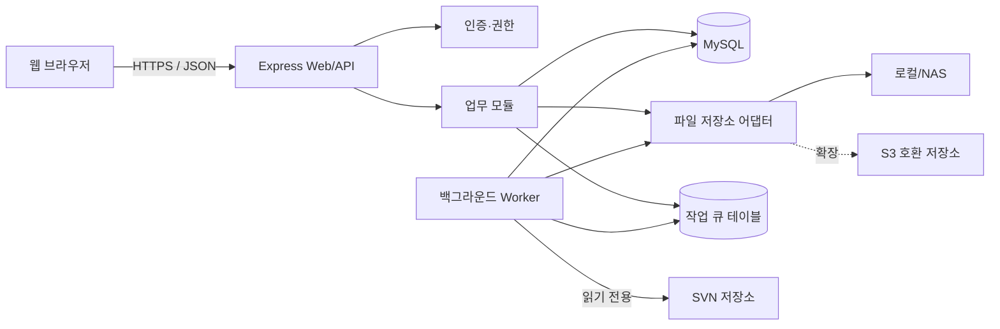
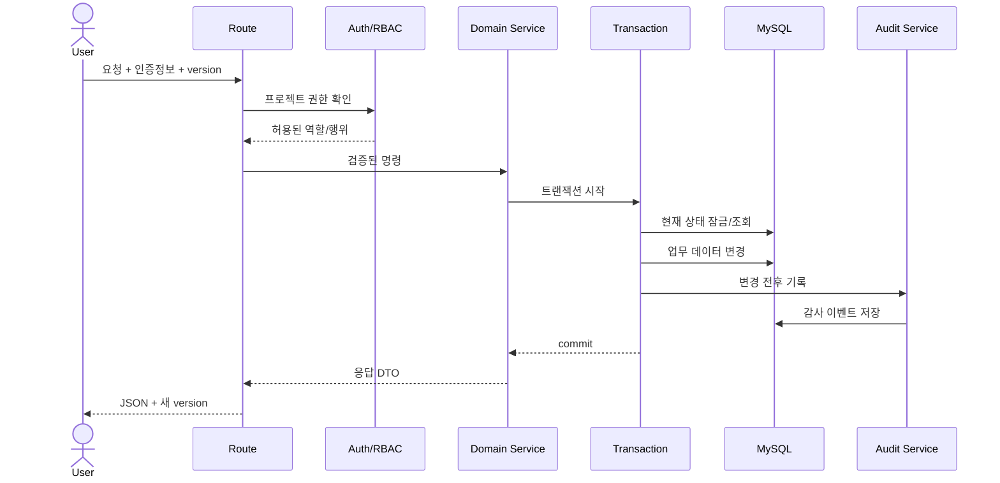
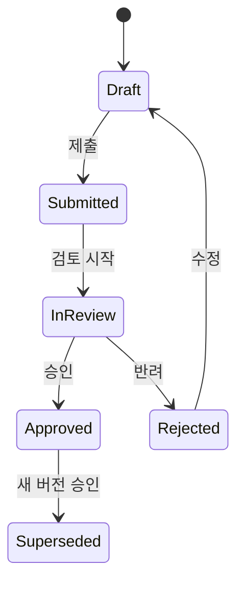
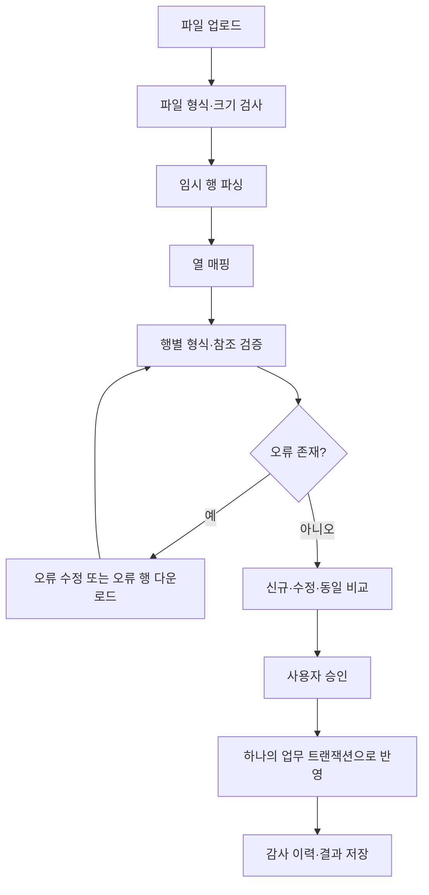

# PMS 시스템 설계

- 상태: 논리 설계 초안 v0.1
- 기준 요구사항: `REQUIREMENTS.md` v0.1
- 설계 원칙: 기존 데이터 보존, 모듈형 모놀리스, 비동기 대량 작업, 추적성 우선

## 1. 설계 목표

- Release 1 기능을 빠르게 제공하면서 이후 테스트·이행 모듈을 같은 구조로 확장한다.
- 프로젝트 경계를 모든 조회와 쓰기의 기본 보안 단위로 사용한다.
- 사용자 화면, Excel, API가 같은 서비스 규칙과 검증을 사용한다.
- 대량 업로드와 SVN 동기화가 일반 화면 요청을 지연시키지 않게 한다.
- 상태 변경, 승인, 파일 버전, 테스트 실행은 재현 가능한 이력을 남긴다.

## 2. 전체 구조



초기에는 하나의 Node.js 애플리케이션 안에서 API와 Worker를 별도 프로세스로
실행한다. 모듈을 서비스 단위로 분리하되 별도 마이크로서비스로 배포하지 않는다.

## 3. 모듈 경계

| 모듈 | 책임 | 주요 요구사항 |
|---|---|---|
| Identity | 로그인, 사용자, 조직, 역할, 프로젝트 구성원 | ORG, NFR-SEC |
| Project | 프로젝트, 단계, 템플릿, 단계 게이트 | PRJ |
| Planning | WBS, 의존관계, 기준선, 진척 스냅샷 | WBS, PRG |
| Import | Excel 업로드, 매핑, 검증, 비교, 반영 | XLS |
| Deliverable | 표준산출물, 프로젝트 산출물, 버전, 승인 | DLV |
| Program | 화면·Batch·API·공통 프로그램 목록 | PGM |
| Quality | 테스트 계획·케이스·실행, 결함 | TST, DEF |
| Deployment | 이행 시나리오, 실행, 승인, 롤백 | DEP |
| Attachment | 파일 메타데이터, 버전, 권한, 미리보기 | ATT |
| Integration | SVN 저장소, revision 동기화, 업무 연결 | SVN |
| Audit | 변경 이력, 이벤트, 알림 | COM, COL |

모듈은 다른 모듈 테이블을 직접 수정하지 않는다. 같은 프로세스 안에서도 공개된
서비스 함수를 통해 변경하고 하나의 업무 트랜잭션으로 묶는다.

## 4. 서버 디렉터리 목표 구조

```text
src/
  app.js
  config/
  db/
    pool.js
    transaction.js
  common/
    errors.js
    validation.js
    pagination.js
  modules/
    identity/
    projects/
    planning/
    imports/
    deliverables/
    programs/
    quality/
    deployment/
    attachments/
    integrations/
    audit/
  workers/
  web/
migrations/
test/
```

현재 `server.js`는 기능을 유지한 채 점진적으로 `src/` 구조로 이동한다. 한 번에
전면 재작성하지 않는다.

## 5. 요청 처리 구조



라우트는 HTTP 변환, 서비스는 업무 규칙, 저장소 계층은 SQL과 행 매핑만 담당한다.

## 6. 인증과 권한

초기 인증은 자체 계정으로 시작할 수 있도록 어댑터로 분리한다. 이후 LDAP/AD 또는
OIDC SSO로 교체해도 사용자와 프로젝트 권한 모델은 유지한다.

권한 확인 순서:

1. 계정 활성 상태와 인증 세션 확인
2. 시스템 역할 확인
3. URL 또는 대상 데이터의 프로젝트 식별
4. 프로젝트 구성원 역할 확인
5. 모듈·행위 권한 확인
6. 필요 시 본인 소유/담당 데이터 범위 확인

권한은 UI 숨김만으로 제어하지 않고 모든 API에서 다시 확인한다.

## 7. 상태 전이

상태가 업무 승인을 의미하는 객체는 임의 `PATCH status`를 허용하지 않고 전이 명령을
사용한다.



산출물 버전, 단계 게이트, 이행 승인은 이 패턴을 공유하되 객체별 허용 역할과
필수 조건을 별도로 정의한다.

## 8. 비동기 작업

다음 작업은 요청 스레드에서 완료될 때까지 기다리지 않는다.

- Excel 파일 파싱과 행 검증
- 승인된 Excel 데이터의 대량 반영
- SVN revision 동기화
- 대시보드 집계와 진척 스냅샷
- 바이러스 검사와 대용량 미리보기 생성

초기 구현은 MySQL의 `pms_jobs` 테이블을 큐로 사용한다. 현재 개발 DB인 MariaDB
10.4에서는 `SKIP LOCKED`를 사용할 수 없으므로 Worker가 고유 lease token을 만든 뒤
`UPDATE ... WHERE status = 'QUEUED' ORDER BY created_at LIMIT 1`로 한 건을 원자적으로
선점하고, 해당 token으로 작업을 조회한다. 재시도 횟수, 마지막 오류, heartbeat와
lease 만료 시각을 함께 기록해 중단된 작업을 회수한다. MariaDB 10.6 이상으로
올린 경우에만 `FOR UPDATE SKIP LOCKED` 방식을 선택할 수 있다. 처리량이 실제 병목이
된 뒤에만 Redis 등 전용 큐를 검토한다.

## 9. Excel 반영 흐름



업로드와 실제 반영을 분리한다. 반영 시점에 대상 데이터 version을 다시 검사하여
미리보기 이후 다른 사용자가 수정한 행을 덮어쓰지 않는다.

## 10. 파일 저장 구조

애플리케이션은 `StorageAdapter` 인터페이스만 사용한다.

- `put(stream, metadata)`
- `get(storageKey)`
- `delete(storageKey)` — 업무 삭제가 아닌 보존정책 작업에서만 사용
- `createPreview(storageKey)`
- `scan(storageKey)`

실제 저장 키는 사용자 파일명과 분리하고 추측 불가능하게 만든다. 다운로드는 DB의
첨부 연결과 프로젝트 권한을 확인한 뒤 스트리밍한다.

## 11. SVN 연동

SVN 연동 계정은 읽기 전용으로 제한한다. Worker가 마지막 성공 revision 이후 로그와
변경 경로를 동기화하며, 커밋 로그에서 업무 ID를 파싱한다. 파싱 실패나 존재하지 않는
ID는 미연결 목록으로 남겨 사용자가 수동 연결할 수 있게 한다.

SVN 장애는 PMS의 일반 데이터 저장을 롤백시키지 않는다.

## 12. 관측성과 오류 처리

- 각 요청에 `requestId`를 부여한다.
- 로그에는 모듈, 사용자 ID, 프로젝트 ID, 결과, 처리시간을 구조화해 기록한다.
- 사용자 응답에는 내부 SQL, 경로, 자격증명을 포함하지 않는다.
- `/api/health/live`는 프로세스 상태, `/api/health/ready`는 DB와 필수 저장소 상태를 확인한다.
- Worker 지연, 실패 작업 수, Excel 오류율, SVN 마지막 성공시각을 운영 지표로 둔다.

## 13. 배포 구조

Release 1의 최소 운영 단위:

- Web/API Node.js 프로세스 1개 이상
- Worker Node.js 프로세스 1개 이상
- MySQL/MariaDB
- 로컬 디스크 또는 NAS 파일 저장소
- TLS 종료용 reverse proxy

서버는 무상태 세션 또는 공유 세션 저장소를 사용해 수평 확장 가능하게 설계한다.

## 14. 주요 설계 결정

| 결정 | 선택 | 이유 |
|---|---|---|
| 애플리케이션 구조 | 모듈형 모놀리스 | 현재 팀·규모에서 트랜잭션과 배포 단순성 우선 |
| DB | MySQL/MariaDB 유지 | 기존 데이터와 운영 환경 보존 |
| 대량 작업 | DB 큐 + Worker | 초기 운영 구성 최소화, 재시도 이력 확보 |
| 파일 | 저장소 어댑터 | 로컬/NAS에서 S3 호환 저장소로 이동 가능 |
| 삭제 | soft delete/보관 기본 | 감사와 추적성 보존 |
| 동시 수정 | version 기반 낙관적 잠금 | 조용한 덮어쓰기 방지 |
| 외부 연동 | 비동기·읽기 전용부터 | PMS 핵심 업무와 장애 격리 |

## 15. 요구사항 추적

| 요구사항 그룹 | 담당 모듈 | 주요 설계 위치 |
|---|---|---|
| `COM`, `PRJ`, `ORG` | Identity, Project, Audit | 본 문서 3·6·7장, 데이터 모델 1·6장, API 6·13장 |
| `WBS`, `PRG` | Planning | 본 문서 3·7장, 데이터 모델 2장, API 7장 |
| `XLS` | Import, Job | 본 문서 8·9장, 데이터 모델 6장, API 8·13장 |
| `DLV`, `PGM` | Deliverable, Program | 데이터 모델 3장, API 9장 |
| `TST`, `DEF` | Quality | 본 문서 7장, 데이터 모델 4장, API 10장 |
| `DEP`, `SVN` | Deployment, Integration | 본 문서 8·11장, 데이터 모델 5장, API 11장 |
| `ATT`, `COL` | Attachment, Notification | 본 문서 10장, 데이터 모델 6장, API 12장 |
| `NFR-SEC`, `NFR-PERF`, `NFR-OPS`, `NFR-UX` | 공통 인프라 | 본 문서 6·8·10·12·13장, API 1~5장 |

상세 요구사항의 수용 기준은 구현 이슈와 테스트 케이스에서 개별 ID까지 연결한다.
설계 변경으로 요구사항 범위가 달라질 때는 `REQUIREMENTS.md`를 먼저 갱신한다.

## 16. 구현 순서

1. 현재 코드의 설정·DB 풀·라우트·서비스 분리
2. 인증 사용자와 프로젝트 멤버십/RBAC
3. WBS CRUD, version, 보관 처리, 감사로그
4. 의존관계 정규화와 순환 검증
5. Excel staging과 검증 Worker
6. 첨부 저장소 어댑터
7. 산출물·프로그램·품질·이행 모듈 순차 추가
