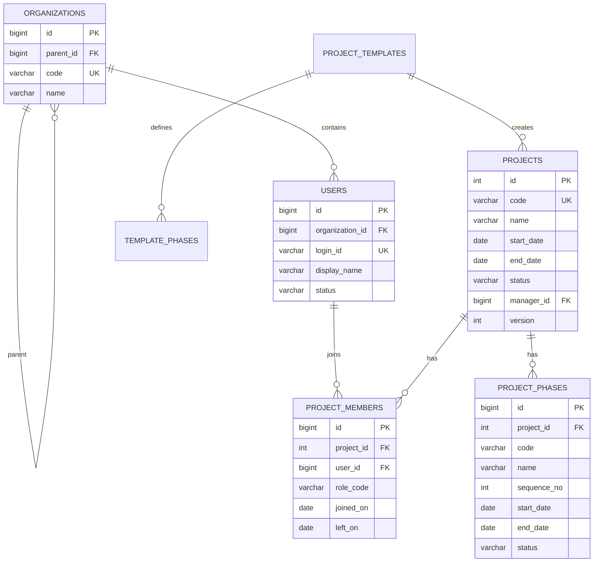
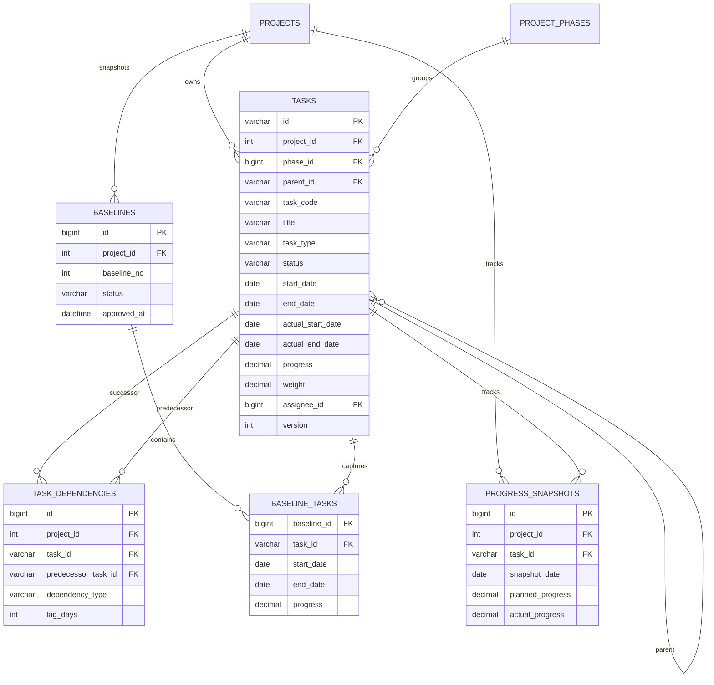
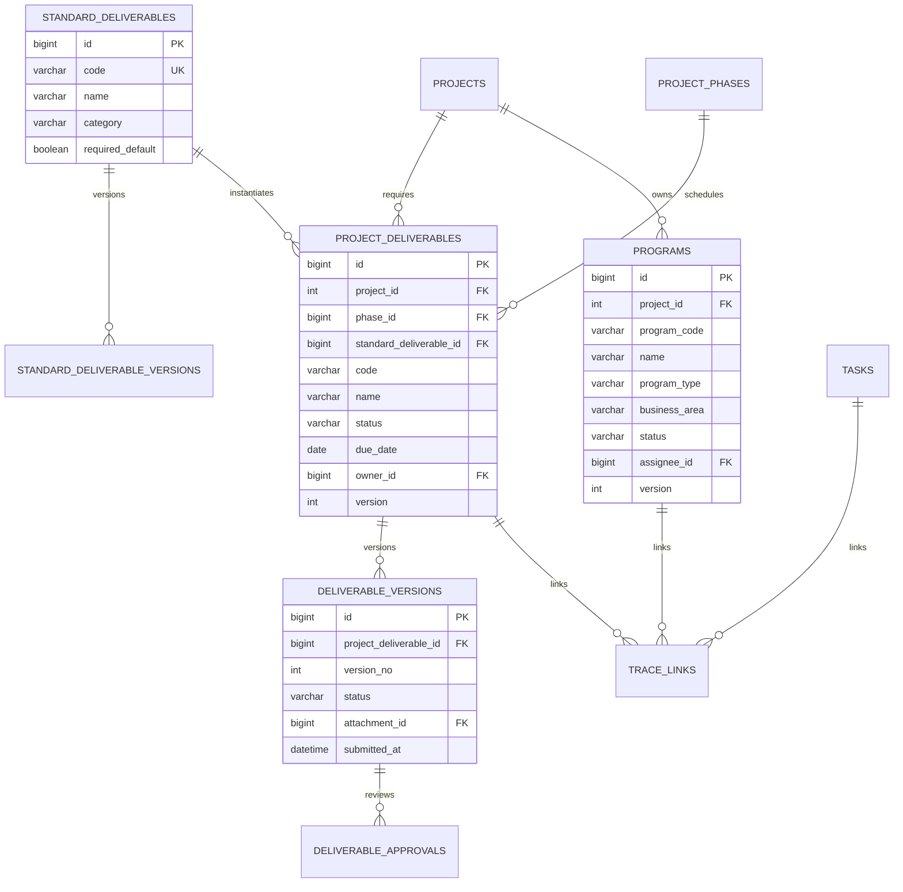
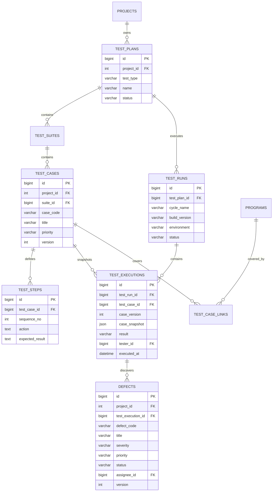
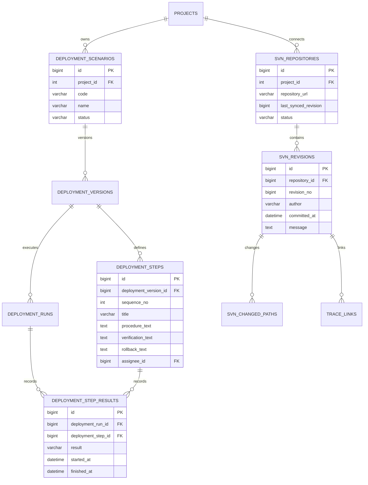
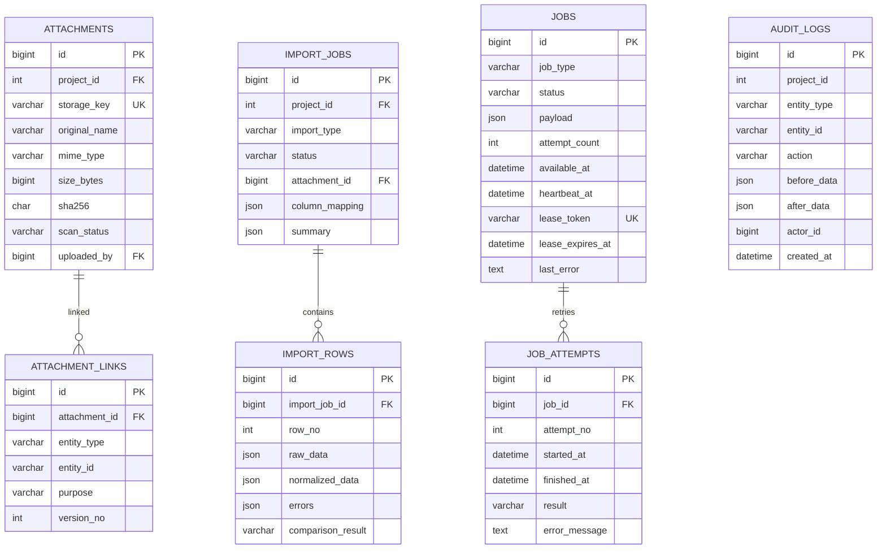

# 데이터 모델 설계

- 상태: 논리 모델 초안 v0.1
- 물리 명명 규칙: 테이블 `pms_` 접두어, snake_case, 날짜는 `DATE`, 시각은 `DATETIME`
- 모든 업무 테이블은 `created_at`, `created_by`, `updated_at`, `updated_by`, `version`을 기본으로 한다.
- 보관 가능한 테이블은 `archived_at`, `archived_by`를 사용한다.

## 1. 핵심 프로젝트와 조직

프로젝트 역할은 초기에는 시스템 정의 코드로 시작하고, 권한 요구가 확정되면
`pms_roles`, `pms_permissions`, `pms_role_permissions`로 분리한다.

## 2. WBS와 진척

기존 `pms_tasks.id VARCHAR(50)`은 데이터 보존을 위해 유지한다. `dependencies` CSV는
연결 테이블로 이관한 뒤 검증 기간 동안 읽기 호환만 제공하고 최종 제거한다.

필수 유일키와 인덱스:

- `tasks(project_id, task_code)` unique
- `tasks(project_id, parent_id, start_date, id)`
- `task_dependencies(project_id, task_id, predecessor_task_id)` unique
- `progress_snapshots(project_id, snapshot_date, task_id)` unique
- `baseline_tasks(baseline_id, task_id)` unique

## 3. 산출물과 프로그램

`TRACE_LINKS`는 여러 모듈의 연결을 조회하기 위한 보조 색인이다. 연결 생성 시 각
도메인 서비스가 대상 존재와 동일 프로젝트 여부를 검증한다. 핵심 소유 관계는 실제
외래키로 유지한다.

## 4. 테스트와 결함

`case_snapshot`은 실행 당시 케이스와 단계의 재현용 사본이다. 검색과 리포트에 필요한
필드는 정규 컬럼으로 유지하고 JSON은 과거 정의 재현에만 사용한다.

## 5. 이행과 SVN

## 6. 첨부, 감사, Excel 작업

다형 연결 테이블의 `entity_type/entity_id`는 허용 목록과 서비스 검증을 적용한다.
첨부 다운로드 때 연결 대상의 프로젝트 권한을 반드시 다시 확인한다.

## 7. 상태 코드

상태 문자열은 DB ENUM보다 공통 코드 또는 CHECK 제약으로 관리한다. 배포 없이 상태를
추가해야 하는 도메인은 공통 코드 테이블을 사용하고, 보안 또는 업무 전이에 직접
영향을 주는 상태는 애플리케이션 상수와 마이그레이션으로 통제한다.

## 8. 데이터 마이그레이션 순서

1. 현재 스키마와 데이터 진단 및 백업
2. 프로젝트·단계 테이블 생성과 기존 `project_id` 프로젝트 생성
3. 사용자·조직·프로젝트 구성원 추가
4. `pms_tasks`에 상태·phase·version·audit 컬럼을 nullable로 추가
5. 기존 담당자 문자열을 사용자와 매핑하고 미매핑 값 보관
6. 의존관계 CSV를 staging에서 검증한 뒤 연결 테이블로 이관
7. 새 코드의 이중 읽기 검증
8. NOT NULL·외래키·CHECK·인덱스를 단계적으로 적용
9. 안정화 후 레거시 컬럼 읽기 제거

각 단계는 작업 수, 프로젝트별 합계, 날짜·진척 위반, 고아 부모, 의존관계 수를
적용 전후 비교한다.
